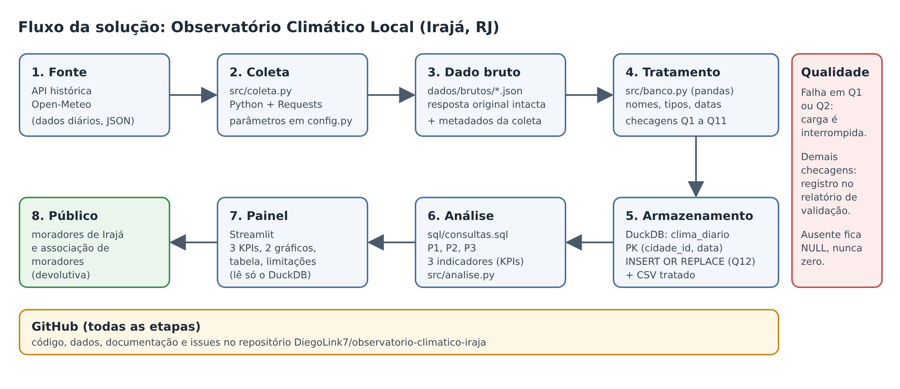

# Observatório Climático Local: Irajá (RJ)

Projeto Integrador Extensionista 2 do curso de Ciência de Dados da UNIMAR.
Aluno: Diego Santos Nogueira (trabalho individual). Professor: Luiz Bueno.

## Objetivo e público-alvo

O projeto organiza dados de temperatura e chuva de Irajá, bairro da Zona Norte do Rio de Janeiro, e transforma esses números num resumo que um morador consegue entender: quais dias foram mais quentes, quanto choveu e em quais dias.

O público são os moradores do bairro, com a associação de moradores como ponte para a comunidade. A ideia é que eles tenham números organizados para conversar sobre os dias de calor forte e de chuva intensa e para embasar pedidos ao poder público.

Este projeto analisa dias que já passaram. Ele não faz previsão do tempo.

## Recorte

| Item | Definição |
| --- | --- |
| Fonte | [Open-Meteo Historical Weather API](https://open-meteo.com/) |
| Localidade | Irajá, Rio de Janeiro (RJ) |
| Coordenadas | latitude -22,8344; longitude -43,3272 |
| Período | 15/10/2026 a 13/11/2026 (30 dias consecutivos) |
| Fuso horário | America/Sao_Paulo |
| Variáveis | temperatura máxima diária (°C), temperatura mínima diária (°C), precipitação diária acumulada (mm) |

Perguntas analíticas:

1. Qual foi a maior temperatura máxima do período e em que dia ela ocorreu?
2. Quanto choveu no total e quais foram os 5 dias mais chuvosos?
3. A temperatura máxima média foi diferente entre dias com chuva e dias sem chuva? Conta como dia com chuva aquele com 1,0 mm ou mais.

Os parâmetros ficam todos em `src/config.py`. Para mudar a localidade ou o período, basta alterar esse arquivo.

## Desenho da solução



O desenho completo está em [`docs/escopo-1/AE2-2`](docs/escopo-1/AE2-2): dicionário de dados v1, modelo lógico v1, plano de qualidade com 12 checagens, plano de análise e wireframe do painel.

## Estágio atual

| Etapa | Situação | Issue |
| --- | --- | --- |
| Coleta pela API e preservação do JSON original | pronta | #1, #2 |
| Tratamento e checagens de qualidade (Q1 a Q12) | pronta | #3 |
| Tabela `clima_diario` e carga no DuckDB (modelo v1) | pronta | #4 |
| Consultas SQL e indicadores | pronta | #5 |
| Painel em Streamlit | próxima etapa, com wireframe pronto | #6 |
| Validação com a comunidade de Irajá | a fazer | #7 |
| Revisão da documentação e devolutiva | a fazer | #8 |

O acompanhamento fica nas [issues do repositório](https://github.com/DiegoLink7/observatorio-climatico-iraja/issues).

## Estrutura

```text
observatorio-climatico-iraja/
├── src/
│   ├── config.py      parâmetros do recorte (local, datas, variáveis, caminhos)
│   ├── coleta.py      coleta na API e gravação do JSON original
│   ├── banco.py       tratamento com pandas, validação e carga no DuckDB
│   └── analise.py     executa as consultas SQL e grava os resultados
├── sql/
│   └── consultas.sql  consultas das perguntas analíticas e dos indicadores
├── dados/
│   ├── brutos/        JSON original da API + metadados da coleta
│   └── processados/   base tratada (CSV), validação, resultados e banco DuckDB
├── painel/            painel Streamlit (próxima etapa)
├── docs/escopo-1/
│   ├── AE1/           planejamento
│   ├── AE2/           relatório da coleta, tratamento e análise inicial
│   └── AE2-2/         desenho da solução: dicionário, modelo, qualidade, wireframe
├── requirements.txt
└── .gitignore
```

## Como executar

Você vai precisar do Python 3.10 ou mais recente e do Git.

1. Clone o repositório e entre na pasta:

   ```bash
   git clone https://github.com/DiegoLink7/observatorio-climatico-iraja.git
   cd observatorio-climatico-iraja
   ```

2. Crie e ative um ambiente virtual:

   ```bash
   python -m venv .venv
   # Windows
   .venv\Scripts\activate
   # Linux ou macOS
   source .venv/bin/activate
   ```

3. Instale as dependências:

   ```bash
   pip install -r requirements.txt
   ```

4. Rode os scripts nesta ordem, sempre a partir da raiz do repositório:

   ```bash
   python src/coleta.py     # baixa os dados e guarda o JSON original
   python src/banco.py      # trata, valida e carrega no DuckDB
   python src/analise.py    # roda as consultas e mostra os resultados
   ```

A API do Open-Meteo usada aqui é gratuita e não pede chave de acesso.

## O banco de dados

O banco fica em `dados/processados/observatorio.duckdb` e tem uma tabela principal, `clima_diario`, em que cada linha é uma localidade em uma data.

| Campo | Tipo | Significado |
| --- | --- | --- |
| cidade_id | VARCHAR | identificador da localidade (`iraja-rj`); parte da chave primária |
| data | DATE | dia do registro; parte da chave primária |
| localidade | VARCHAR | nome da localidade analisada |
| latitude_grade | DOUBLE | latitude do ponto de grade usado pela API |
| longitude_grade | DOUBLE | longitude do ponto de grade usado pela API |
| temp_max_c | DOUBLE | temperatura máxima do dia a 2 m do solo, em °C |
| temp_min_c | DOUBLE | temperatura mínima do dia a 2 m do solo, em °C |
| precipitacao_mm | DOUBLE | chuva acumulada no dia, em mm |
| dia_com_chuva | BOOLEAN | dia com 1,0 mm de chuva ou mais (calculado) |
| fonte | VARCHAR | origem dos dados |
| coletado_em | TIMESTAMP | data e hora da coleta (horário de São Paulo) |

Rodar o `banco.py` de novo não duplica nada. A chave primária é (`cidade_id`, `data`) e a carga usa `INSERT OR REPLACE`, que atualiza o dia em vez de criar outra linha. Se o banco tiver sido criado numa versão anterior, sem `cidade_id`, o script recria a tabela no modelo novo e avisa no terminal.

Também dá para consultar o banco direto pelo Python:

```python
import duckdb
con = duckdb.connect("dados/processados/observatorio.duckdb", read_only=True)
print(con.sql("SELECT * FROM clima_diario ORDER BY data").df())
```

## Tratamento e validação

O `banco.py` roda as 12 checagens do plano de qualidade (Q1 a Q12) e grava o resultado em `dados/processados/relatorio_validacao.txt`. Entre elas estão a estrutura e as unidades da resposta, os campos obrigatórios, datas válidas e dentro do recorte, duplicidade de `cidade_id` + `data`, cobertura dos 30 dias, ausências, mínima não maior que a máxima, chuva não negativa e faixas plausíveis para o Rio. A lista completa, com a ação para cada falha, está em [`docs/escopo-1/AE2-2`](docs/escopo-1/AE2-2).

Valores ausentes ficam como NULL no banco. Trocar um ausente por zero inventaria um dado: 0 mm de chuva ou 0 °C num dia em que nada foi medido.

## Limitações

- Os dados do Open-Meteo vêm de modelos meteorológicos e reanálise, calculados para uma grade. Eles não são medições de uma estação instalada em Irajá e podem diferir do que um termômetro ou pluviômetro no bairro registraria. Chuva muito localizada pode aparecer menor do que foi.
- Trinta dias mostram só um retrato do período. Não servem para falar em tendência climática, e qualquer diferença entre dias com e sem chuva não prova causa e efeito.
- Os dias mais recentes podem ainda não estar consolidados quando a coleta é feita. Se isso acontecer, a validação lista os dias com dado ausente.
- O projeto não coleta dados pessoais. Nas conversas com a comunidade, nomes só entram com autorização.
