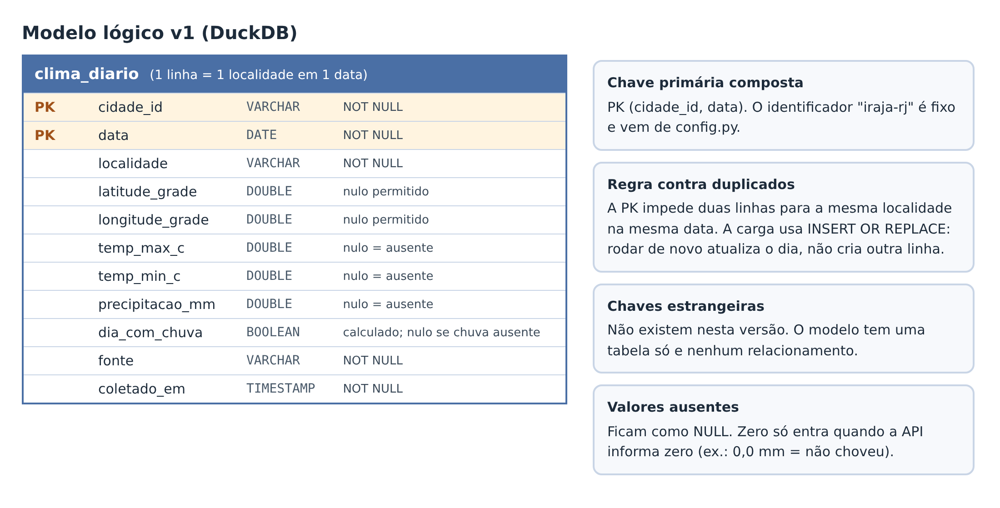
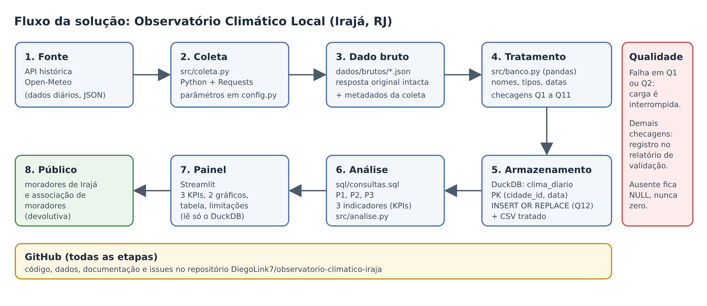
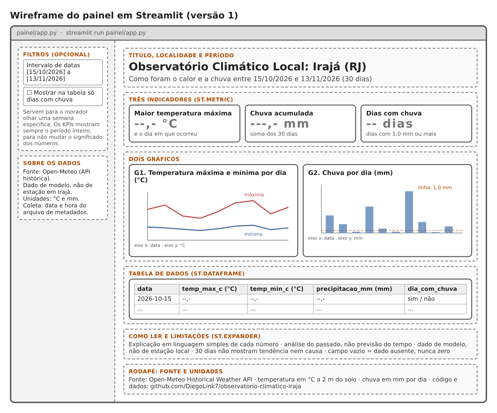

# AE2-2: Desenho da solução de dados

Documento completo: [AE2-2_Desenho_Solucao_Diego_Santos_Nogueira.pdf](AE2-2_Desenho_Solucao_Diego_Santos_Nogueira.pdf)

| Arquivo | Conteúdo |
| --- | --- |
| `AE2-2_Desenho_Solucao_Diego_Santos_Nogueira.pdf` | dicionário de dados, modelo lógico, plano de qualidade, plano de análise, wireframe e comunicação extensionista |
| `modelo_logico_v1.png` | diagrama da tabela `clima_diario` |
| `fluxo_solucao.png` | fluxo da API até o público |
| `wireframe_painel.png` | esboço do painel em Streamlit |

## Dicionário de dados v1 (tabela `clima_diario`)

| Campo | Tipo | Descrição | Origem | Regra de preenchimento/validação |
| --- | --- | --- | --- | --- |
| cidade_id | VARCHAR | identificador fixo da localidade (`iraja-rj`) | configuração | obrigatório; parte da PK |
| data | DATE | dia do registro (AAAA-MM-DD) | campo `time` da resposta diária | obrigatório; data válida; entre 15/10/2026 e 13/11/2026; parte da PK |
| localidade | VARCHAR | "Irajá, Rio de Janeiro (RJ)" | configuração | obrigatório |
| latitude_grade | DOUBLE | latitude do ponto de grade da API (graus) | campo `latitude` da resposta | opcional; perto da coordenada pedida |
| longitude_grade | DOUBLE | longitude do ponto de grade da API (graus) | campo `longitude` da resposta | opcional; perto da coordenada pedida |
| temp_max_c | DOUBLE | temperatura máxima diária a 2 m (°C) | `temperature_2m_max` | pode ser nulo (ausente, nunca zero); >= temp_min_c; alerta fora de 0 a 45 °C |
| temp_min_c | DOUBLE | temperatura mínima diária a 2 m (°C) | `temperature_2m_min` | pode ser nulo; <= temp_max_c; alerta fora de 0 a 45 °C |
| precipitacao_mm | DOUBLE | chuva acumulada no dia (mm) | `precipitation_sum` | pode ser nulo; >= 0; 0,0 é valor real; alerta acima de 350 mm |
| dia_com_chuva | BOOLEAN | dia com 1,0 mm ou mais | cálculo | nulo quando a chuva é nula |
| fonte | VARCHAR | "Open-Meteo Historical Weather API" | configuração | obrigatório |
| coletado_em | TIMESTAMP | data e hora da coleta (horário de São Paulo) | metadados da coleta | obrigatório |

Chave primária: (`cidade_id`, `data`). Não há chaves estrangeiras nesta versão. A carga usa `INSERT OR REPLACE`, então rodar de novo não duplica registros.

## Plano de qualidade (Q1 a Q12)

| Checagem | Regra | Ação em caso de falha |
| --- | --- | --- |
| Q1. Estrutura e unidades | resposta traz `time` e as 3 variáveis; unidades °C, °C e mm | interromper sem carregar |
| Q2. Campos obrigatórios | cidade_id, localidade, fonte e coletado_em não vazios | impedir a carga |
| Q3. Datas válidas | data converte para AAAA-MM-DD | descartar a linha e registrar |
| Q4. Datas no recorte | entre 15/10/2026 e 13/11/2026 | descartar a linha e registrar |
| Q5. Duplicidade | uma linha por cidade_id + data | manter a primeira, listar e investigar; PK bloqueia no banco |
| Q6. Cobertura | 30 datas consecutivas | listar faltantes; não inventar dias |
| Q7. Ausências | contar nulos por variável | manter NULL, nunca zero |
| Q8. Tipos numéricos | valor converte para número | texto inválido vira NULL e é registrado |
| Q9. Mínima <= máxima | temp_min_c <= temp_max_c | listar e conferir no JSON original |
| Q10. Chuva não negativa | precipitacao_mm >= 0 | listar e conferir no JSON original |
| Q11. Faixas plausíveis | 0 a 45 °C; 0 a 350 mm | marcar e conferir antes da análise |
| Q12. Carga sem duplicação | duas cargas mantêm a mesma contagem | investigar PK e carga |

